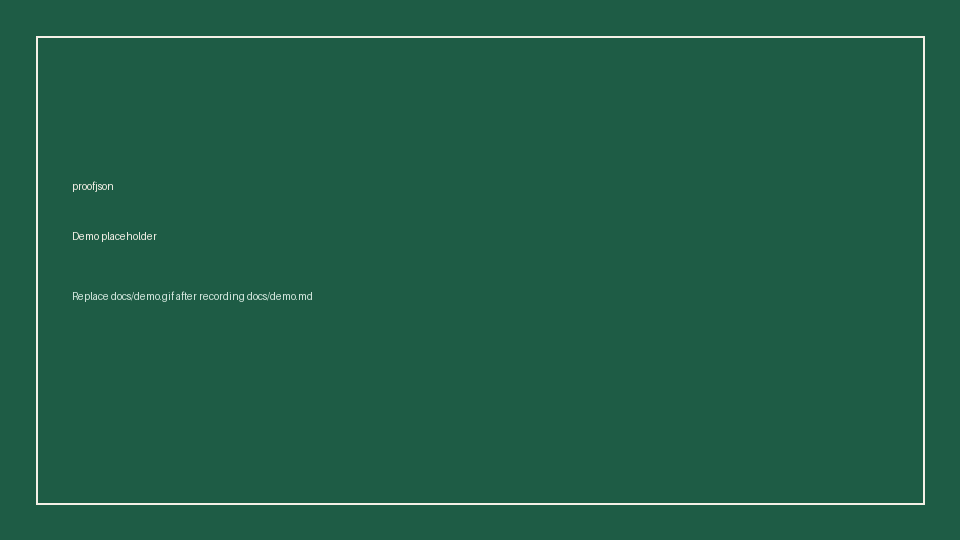

# proofjson

A trust layer for LLM extraction.

Give proofjson a PDF and a JSON Schema (or a Pydantic model). It returns schema-valid JSON where every field carries a source quote, a page number, and a confidence score. Quotes that are not in the page text, after normalization and a digit-safe fuzzy match, are flagged `unverified`. A local review page lets a person approve, fix, or reject each field before anything is exported.



The image above is a placeholder frame. Replace `docs/demo.gif` after recording the script in [docs/demo.md](docs/demo.md).

## 30-second quickstart

From a checkout of this repo:

```bash
uv sync
uv run proofjson extract examples/invoice/invoice.pdf --schema examples/invoice/schema.json --model mock -o out.json
uv run proofjson review out.json
uv run proofjson eval examples
```

`--model mock` replays `cassette.json` next to the PDF, so the quickstart needs no API key. `review` serves [http://127.0.0.1:8765](http://127.0.0.1:8765) and writes `out.reviewed.json`. It exits 0 only when every field has been approved, edited, or rejected.

Once the package is on PyPI, the same tool is:

```bash
uvx proofjson extract invoice.pdf --schema schema.json -o out.json
```

That publish step is not done yet. Do not expect `uvx proofjson` to resolve until then.

A live model uses the same command with a provider string and a key in the environment:

```bash
export GEMINI_API_KEY=...
uv run proofjson extract examples/invoice/invoice.pdf --schema examples/invoice/schema.json -o out.json
```

The default model is `gemini/gemini-2.5-flash`.

## Python API

```python
from proofjson import extract

result = extract(
    "examples/invoice/invoice.pdf",
    "examples/invoice/schema.json",
    model="mock",
)
result.data["invoice_number"]  # "INV-1042"
result.evidence["invoice_number"]["verified"]
result.needs_review
```

`schema` may be a JSON Schema dict, a path to one, or a Pydantic model class. `result.document` is the file written by the CLI: your values, plus `_evidence` and `_meta`.

## How evidence and verification work

Each page is read from the PDF text layer (pypdf). The model sees that page, the user schema, the fields already extracted, and a short tail from the previous page so a sentence that crosses a page break still has context. It may only quote the current page. Temperature is 0.1. Providers that support it are asked for structured output.

After the pages are merged, the values are checked against the schema. If validation fails, proofjson makes one repair call that includes the errors, then stops.

Every kept field is then checked against the text of the page it cites:

1. Exact substring.
2. Normalized substring: Unicode NFKC, casefold, collapsed whitespace, then punctuation removed.
3. Fuzzy match, only for quotes of at least 12 characters, and only when the digits in the quote and the matched window are identical. A wrong total cannot inherit `verified: true` from a nearby amount. The match ratio threshold is 0.90.

Anything else is `verified: false`. A field also needs review when its confidence is under `--min-confidence` (default 0.80), or when schema errors remain after the repair. The invoice sample flags `notes` because its confidence is 0.75, even though the quote is on the page. The receipt sample flags `total` because the cassette quote is not on the page at all. That second case is planted so the eval is not a fake 100% verified rate.

Scanned pages with no text layer fail with a clear error. OCR is a v0.2 item, not part of this release.

## Example output

`out.json` for the sample invoice (evidence abbreviated; the real file has one `_evidence` entry per field, and `_meta.schema` holds the schema used for review):

```json
{
  "invoice_number": "INV-1042",
  "invoice_date": "2026-03-14",
  "due_date": "2026-04-13",
  "vendor": {"name": "Northwind Trading Co.", "city": "Springfield"},
  "bill_to": {"name": "Ada Example", "city": "Shelbyville"},
  "line_items": [
    {"description": "Canvas tote bag", "qty": 2, "amount": 48.0},
    {"description": "Steel water bottle", "qty": 1, "amount": 24.0},
    {"description": "Linen notebook", "qty": 3, "amount": 36.0}
  ],
  "subtotal": 108.0,
  "tax": 20.4,
  "total": 128.4,
  "notes": "Thank you for your demo order.",
  "_evidence": {
    "invoice_number": {
      "quote": "Invoice number: INV-1042",
      "page": 1,
      "confidence": 1.0,
      "verified": true
    },
    "total": {
      "quote": "Total due: 128.40",
      "page": 2,
      "confidence": 1.0,
      "verified": true
    },
    "notes": {
      "quote": "Notes: Thank you for your demo order.",
      "page": 2,
      "confidence": 0.75,
      "verified": true
    }
  },
  "_meta": {
    "proofjson_version": "0.1.0",
    "model": "mock",
    "source": "/absolute/path/to/examples/invoice/invoice.pdf",
    "page_count": 2,
    "min_confidence": 0.8,
    "needs_review": true,
    "validation_errors": []
  }
}
```

`source` is the absolute path of the PDF. The review server opens it again to show the page text with the quote highlighted.

The receipt's total looks like this on purpose:

```json
"total": {
  "quote": "Complimentary dessert included",
  "page": 1,
  "confidence": 0.9,
  "verified": false
}
```

The value is still `9.75`, which is what the page says. The quote is not, so a person has to decide.

## Review

`proofjson review out.json` is one HTML page served by FastAPI on `127.0.0.1:8765`.

- The left side is the extracted page text. The active field's quote is marked.
- The right side is one card per field: value, quote, page, confidence, verified or not.
- Approve keeps the value. Save edit changes it and keeps the original quote as evidence of what the model saw. Reject keeps the value in the JSON (so the schema still validates) and records the rejection.
- Save writes `out.reviewed.json`. Save and close stops the server.

Exit 0 means every field was decided. Exit 1 means the file is missing or something is still open. That is the check to use in a script.

## Providers

Keys are read from the environment only. There is no key flag and no `.env` loader.

| Provider | Model string | Environment |
| --- | --- | --- |
| Gemini | `gemini/gemini-2.5-flash` | `GEMINI_API_KEY` or `GOOGLE_API_KEY` |
| OpenAI | `openai/gpt-4o-mini` | `OPENAI_API_KEY`, optional `OPENAI_BASE_URL` |
| Anthropic | `anthropic/claude-sonnet-4-5` | `ANTHROPIC_API_KEY` |
| Ollama | `ollama/llama3.2` | `OLLAMA_HOST` (default `http://127.0.0.1:11434`) |
| Mock | `mock` | `cassette.json` beside the PDF, or `--cassette` |

Gemini and OpenAI are asked for JSON schema output. Anthropic is forced to call an `emit_extraction` tool. Ollama receives the schema as its `format`. All of them run at temperature 0.1.

## Examples

Three generated documents. No real personal data. The vendor form is a sample record, not a government form. `000-00-0000` is the conventional invalid taxpayer id.

| Directory | What it is |
| --- | --- |
| `examples/invoice` | Two-page invoice. The second page is where the total lives, so carry-over context matters. |
| `examples/receipt` | Cafe receipt with one planted unverified quote. |
| `examples/vendor_form` | One-page vendor record. |

Regenerate them with `uv sync --extra dev` and `uv run python examples/generate_fixtures.py`.

## Eval

```bash
uv run proofjson eval examples
```

Field accuracy is an exact match on each expected leaf (numbers within `1e-6`, strings compared after stripping). The verified-quote rate is how many evidence entries have `verified: true`. Repeat `--model` to add a column. Live models call the API; `mock` does not.

This is the mock run against the shipped cassettes. It is a fixture check, not a live bake-off:

| model | fixtures | fields | correct | field accuracy | verified | verified-quote rate |
| --- | ---: | ---: | ---: | ---: | ---: | ---: |
| mock | 3 | 37 | 37 | 100.0% | 36 | 97.3% |

| fixture | model | field accuracy | verified-quote rate |
| --- | --- | ---: | ---: |
| invoice | mock | 100.0% (20/20) | 100.0% (20/20) |
| receipt | mock | 100.0% (9/9) | 88.9% (8/9) |
| vendor_form | mock | 100.0% (8/8) | 100.0% (8/8) |

The command also prints a per-field table. `total` is correct on both the invoice and the receipt (`100.0% (2/2)`), and the receipt's quote for that field is the one that fails verification.

## How it works

```text
PDF --pypdf--> page text
            --> for each page: model(schema, page, previous tail, fields so far)
            --> merge, higher confidence wins
            --> jsonschema (one repair retry)
            --> quote check on the cited page
            --> values + _evidence
            --> proofjson review --> *.reviewed.json
```

## Development

```bash
uv sync --extra dev
uv run pytest
```

CI runs that on Python 3.10–3.13.

## Roadmap

v0.2 is the rest of the trust layer that this release deliberately leaves out:

- OCR for scanned pages that have no text layer
- A pdf.js view that highlights the quote on the rendered page, not only in the extracted text
- `proofjson batch` for a folder, with `--min-confidence` as a gate
- Live eval numbers for Gemini, OpenAI, Anthropic, and Ollama, checked into this README
- Layout-aware text (columns and tables) via pdfplumber
- A PyPI release so `uvx proofjson` works
- More than one repair retry when the schema is still wrong

## License

MIT. Copyright 2026 JonColin (JC) Senka.
